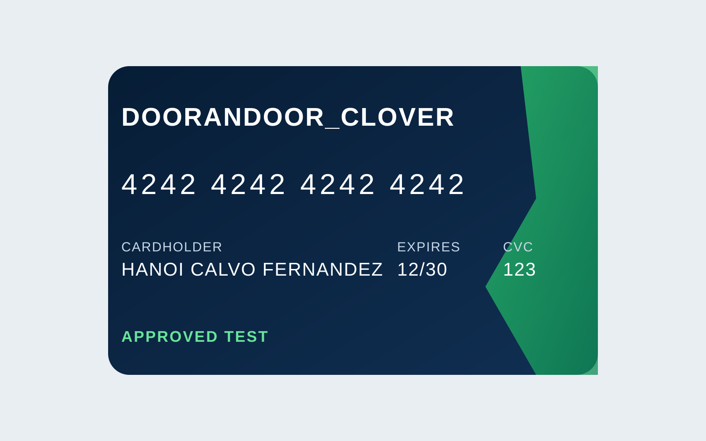
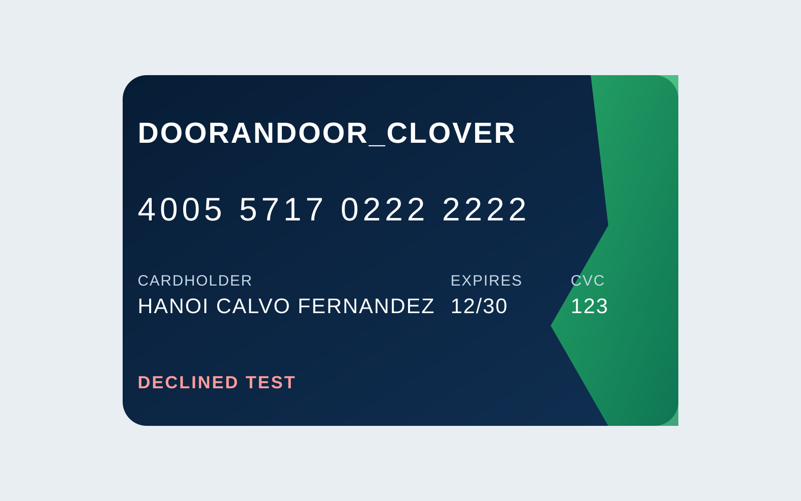

# Tarjetas de capacitación Clover Sandbox

Estas tarjetas son únicamente para demostración y validación en **Clover
Sandbox**. No son tarjetas reales ni deben usarse en Gestión o producción.

| Escenario | Imagen | Número sandbox | Vencimiento | CVV/CVC | Resultado esperado |
|---|---|---|---|---|---|
| Aprobación |  | `4242 4242 4242 4242` | `12/30` | `123` | Cobro aprobado y pago registrado en Odoo. |
| Rechazo |  | `4005 5717 0222 2222` | `12/30` | `123` | Clover rechaza el cobro; no se crea pago contable. |

Las imágenes son material visual de capacitación a nombre de **Hanoi Calvo
Fernández**. Los números proceden de la guía oficial de tarjetas de prueba de
Clover. Clover permite cualquier fecha futura y cualquier CVC de tres dígitos
para estas pruebas.

## Uso

1. En una factura publicada con saldo, abra **Registrar pago** y seleccione el
   diario **Clover**.
2. Indique el importe a cobrar y pulse crear pago.
3. Complete el formulario seguro integrado con una combinación de la tabla.
4. Compruebe la operación en Clover Sandbox y el resultado en la factura y el
   Control de Cobros de Odoo.
