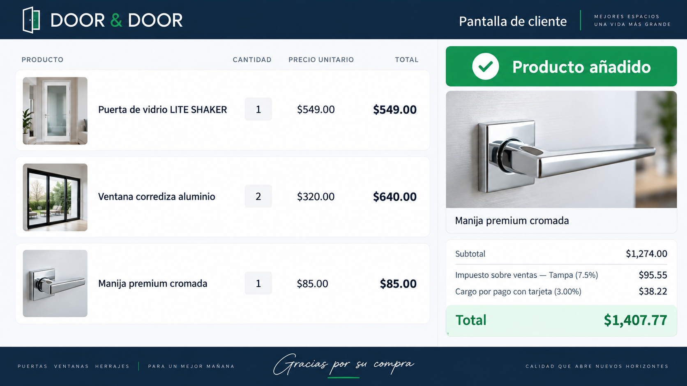

# Pantalla de cliente — propuesta visual

Esta maqueta sirve como referencia para la implementación inicial del módulo.
La pantalla se abrirá manualmente por el gestor de ventas en un segundo monitor
y mostrará únicamente información comercial de la venta o factura activa:

- Productos, imágenes, cantidades y precios.
- Último producto agregado destacado.
- Subtotal, impuesto de la ciudad seleccionada, cargo de tarjeta y total.
- Estado de cobro sin exponer datos sensibles, datos de tarjeta ni controles de
  administración.

La URL implementada usa un token temporal por factura, vence a las cuatro horas
y deja de estar disponible al cerrarla desde la factura. Se actualiza cada tres
segundos y no muestra el nombre, correo, teléfono ni dirección del cliente.

## Estados visibles de pago

La pantalla consulta el estado contable de la factura y la última operación
Clover asociada. Puede comunicar: pendiente de pago, validación del titular,
autorización OTP pendiente, pago en proceso, pago aprobado, pago parcial,
confirmado, rechazado o en revisión. No muestra códigos OTP, referencias de
tarjeta ni datos del cliente.

## Promociones iniciales

Se incluyen tres imágenes con marca de agua DoorAndDoor como punto de partida:
ventana arqueada, puerta Denver y puerta Shaker. Los administradores y editores
del sitio podrán gestionarlas desde la configuración del módulo.
